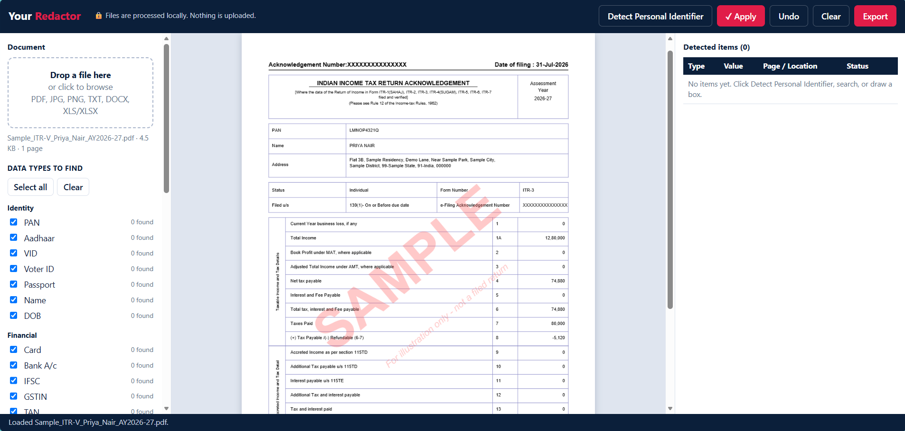
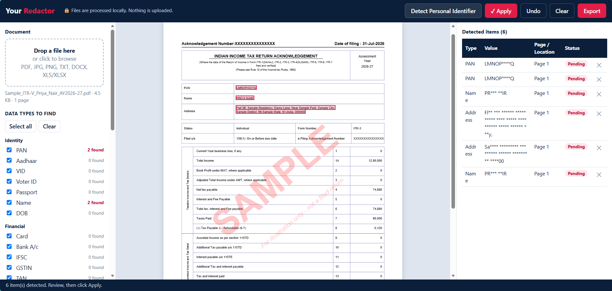
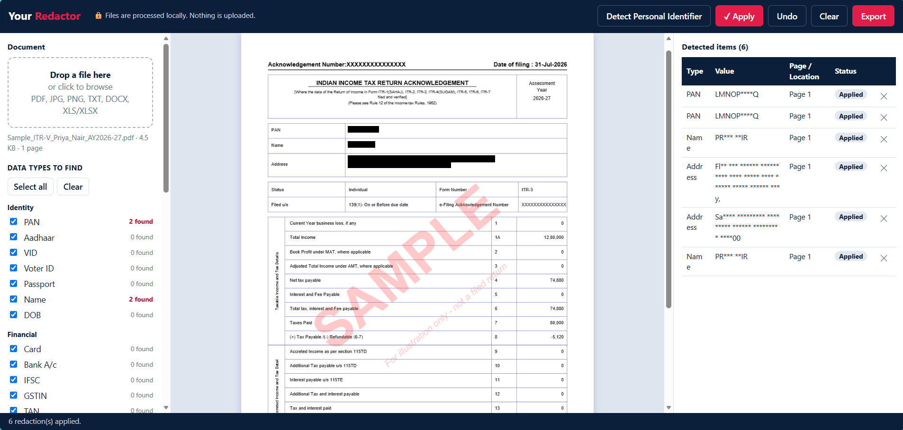
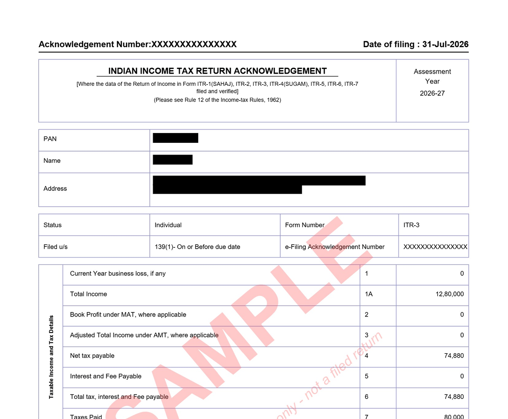

# Your Redactor

> Secure, offline redaction of personal data in financial and compliance documents.

Audit samples, KYC records and bank statements routinely contain sensitive personal information: PAN, Aadhaar, bank account numbers and residential addresses. A single missed identifier before a document is shared can result in a data privacy breach and regulatory exposure.

**Your Redactor** automatically identifies personal identifiers within a document, allows each item to be reviewed, and permanently redacts them before the file is shared. All processing takes place locally in the browser; no data is uploaded or stored.

🔗 **[Launch the live tool](https://caswetamohanty.github.io/Your-Redactor/Your_Redactor.html)**

---

## The problem it solves

Redacting by hand means scrolling page by page and hoping you didn't miss a 12-digit number on page 9. The online alternative means uploading a client's confidential file to a stranger's server, which is the very risk you're trying to avoid.

Your Redactor takes a third route:
- **It finds the data for you.** More than 20 identifier types are detected in one click.
- **You stay in control.** Every match waits for your review before it's applied.
- **The file never leaves your device.** Detection, redaction and export all happen inside your browser.

## Built for risk, internal audit and control testing

Audit work runs on evidence, and evidence is full of personal data. Every control test pulls samples: invoices, payroll registers, vendor masters, KYC files, bank statements, tax returns. Those samples then travel into working papers, review notes, emails to process owners and folders shared with external auditors. Each step is a chance for personal data to end up somewhere it shouldn't.

Here's how Your Redactor fits into a risk and audit workflow:

| Audit activity | How Your Redactor helps |
|---|---|
| **Control testing (SOX / ICFR)** | Redact employee PAN, bank account and Aadhaar details from payroll, reimbursement and vendor payment samples before filing them as test evidence. |
| **Audit working papers** | Keep only what the test needs. The amount, date and approval stay visible, while personal identifiers are removed. This supports data minimisation under privacy laws such as India's DPDP Act, 2023 and GDPR. |
| **Sharing with external auditors or offshore teams** | Send sample documents for walkthroughs and reliance testing without exposing customer or employee data outside the organisation. |
| **Audit observations and reports** | Attach supporting evidence to findings shared with process owners, management or the audit committee, without revealing whose records were sampled. |
| **Vendor and third-party reviews** | Mask bank account numbers, GSTIN and contact details when reviewing vendor master changes or onboarding files. |
| **Process walkthroughs and training** | Turn real documents into clean examples for RCMs, narratives, flowcharts and team training. |
| **Data privacy audits** | Use detection as a quick check of which identifiers a document actually holds before deciding how it should be stored or shared. |

**Why it suits audit work**
- **No data leaves the device.** You don't have to justify uploading client data to a third-party website. That's often the first question an IT or data-protection review will ask.
- **Built-in review step.** Nothing is redacted until you approve it, the same way a reviewer signs off on a test.
- **Permanent redaction.** Exported PDFs are flattened to images, so a black box can't be removed later to reveal the data underneath. This is a common weakness of manual redaction in PDF editors.
- **Traceable.** The detected-items list shows what was found, what type it was and on which page, so you can confirm complete coverage before export.

## See it in action

**1. Upload a document.** Your file opens in the preview, and the data types to search for are listed on the left.

**2. Detect personal identifiers.** Every match is highlighted in red and listed on the right as *Pending*. Values in the list are partly masked, so the review panel doesn't reveal the data either.

**3. Apply the redactions.** Review the list, remove anything that should stay visible, then click **Apply**.

**4. Export.** The downloaded PDF is flattened, so the blacked-out text cannot be copied or recovered.

*Screenshots use a sample ITR-V with dummy data.*

## Features

- **Works fully offline.** A single HTML file. No installation, no login, no server.
- **Auto-detects 20+ identifier types**, grouped as:
  | Group | Data types |
  |---|---|
  | Identity | PAN, Aadhaar, VID, Voter ID, Passport, Name, Date of birth |
  | Financial | Card number (Luhn-checked), Bank A/c, IFSC, GSTIN, TAN, TIN, UPI ID |
  | Contact & location | Email, Mobile, IP address, Address, PIN code |
  | Employment & business | UAN, Employee ID, Trade Name |
  | Visual | Embedded images and QR codes |
- **Text search:** find and mark any word or phrase (with optional match case).
- **Manual redaction:** drag a box on a PDF or image page, or select text in a text file.
- **Review before applying:** every item is listed as *Pending* with its type, a partly masked value and its page, so you can remove false positives before clicking **Apply**.
- **Match count per data type**, shown next to each checkbox.
- **Undo and Clear** for full control.
- **Secure export:** PDFs are flattened to images, so redacted content **cannot be recovered** by copying text or removing the black boxes.

## Supported files

| Input | Export |
|---|---|
| PDF, JPG, PNG | PDF or PNG (flattened) |
| DOCX, XLS, XLSX, TXT, CSV, LOG, JSON, MD | TXT |

> Legacy `.doc` files are not supported. Save them as `.docx` first.
> Images have no text layer (no OCR), so use manual boxes or Image/QR detection for them.

## How to use

1. Open `Your_Redactor.html` in Chrome, Edge or Firefox (or use the live demo link above).
2. Drag a file into the drop zone, or click the drop zone to browse.
3. Tick the data types you want to find, then click **Detect Personal Identifier**.
4. Review the *Detected items* list. Remove anything that should stay visible, and draw boxes for anything missed.
5. Click **✓ Apply**, then **Export**.

## Running it fully offline

The tool loads its helper libraries from a CDN the first time. To use it with no internet at all, create a `lib` folder next to `Your_Redactor.html` and place these files in it:

| File | Source |
|---|---|
| `pdf.min.js`, `pdf.worker.min.js` | [PDF.js 3.11.174](https://cdnjs.com/libraries/pdf.js/3.11.174) |
| `jspdf.umd.min.js` | [jsPDF 2.5.1](https://cdnjs.com/libraries/jspdf/2.5.1) |
| `mammoth.browser.min.js` | [Mammoth 1.6.0](https://cdnjs.com/libraries/mammoth/1.6.0) |
| `xlsx.full.min.js` | [SheetJS 0.18.5](https://cdnjs.com/libraries/xlsx/0.18.5) |

## Privacy

- Files are read only by your browser and never leave your device.
- No analytics, cookies, tracking or accounts.

## Limitations

- Name, Address, Bank A/c, PIN code and Trade Name detection depend on labels in the document (for example "Name:", "Address:"). **Always review results before applying.**
- No OCR, so text inside scanned PDFs or images is not detected automatically.
- QR code detection needs a browser that supports the Barcode Detection API (Chrome or Edge).
- Word and Excel files are exported as redacted plain text, not in their original format.

## Built with

HTML, CSS and JavaScript, plus [PDF.js](https://mozilla.github.io/pdf.js/), [jsPDF](https://github.com/parallax/jsPDF), [Mammoth](https://github.com/mwilliamson/mammoth.js) and [SheetJS](https://sheetjs.com/).

## License

Released under the [MIT License](LICENSE).

> **Disclaimer:** This tool helps with redaction but does not guarantee that all sensitive data is found. The user is responsible for reviewing the output before sharing it.

## Author

**CA Sweta Mohanty**
Risk Management Professional | Internal Audit | SOX | GRC
[LinkedIn](https://www.linkedin.com/in/caswetamohanty). 📧 [csawetamohanty@gmail.com](mailto:csawetamohanty@gmail.com)

